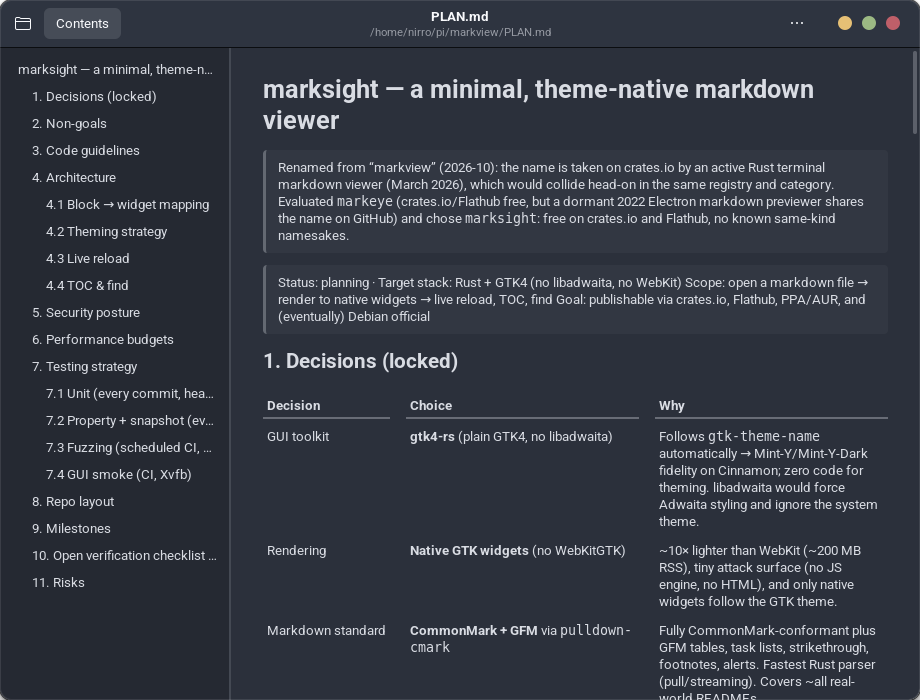

<p align="center"></p>

# marksight

A minimal, theme-native markdown viewer.

Renders Markdown with **native GTK 4 widgets** — no browser engine, no
JavaScript, no HTML. Because rendering is plain widgets, marksight follows your
desktop theme automatically: light or dark, Mint-Y or Adwaita, with zero
configuration.



## Features

- **CommonMark + GFM**: tables (with alignment), task lists, footnotes,
  strikethrough, alerts (`> [!NOTE]` …), images, autolinks
- **Live reload**: the document re-renders shortly after every save
- **Table of contents**: collapsible sidebar (`F9`), click to jump
- **Find in document**: `Ctrl+F`, highlighted matches, `Enter`/`Shift+Enter`
  to cycle, match counter
- **Theme-native styling**: only theme-defined colors are used; nothing is
  hardcoded
- **Portal-clean file access**: opens files through the XDG portal, so it
  works unchanged inside Flatpak confinement
- **Small and safe**: no network, no JavaScript, no HTML rendering, no
  `unsafe`

Raw HTML in documents is **dropped, never rendered** — the classic viewer XSS
vector does not exist here.

## Keyboard shortcuts

| Keys | Action |
| --- | --- |
| `Ctrl+O` | Open a file |
| `Ctrl+F` | Find in document |
| `Enter` / `Shift+Enter` | Next / previous match |
| `Esc` | Close find |
| `F9` | Toggle contents sidebar |
| `Ctrl+W` / `Ctrl+Q` | Close window / quit |

## Translations

The interface ships in English plus 56 translated locales. The catalogs
are machine translations, checked for terminology, placeholders and plural
forms but not reviewed by native speakers; quality varies, and the smaller
languages especially deserve a human eye. Improvements are welcome: edit
`po/<locale>.po` (conventions and tooling in `po/README.md`) and open a pull
request.

## Install

### From source

Requires Rust 1.85+, GTK 4.10+ development packages, and pkg-config.

```sh
sudo apt install libgtk-4-dev pkg-config   # Debian/Ubuntu/Mint
make
sudo make install
```

Or build a package (the easy way needs `cargo install cargo-deb`, one time):

```sh
make deb                                   # -> packaging/deb/marksight_*.deb
sudo apt install ./packaging/deb/marksight_*.deb
```

`make deb` uses cargo-deb when installed and falls back to the
dpkg-buildpackage flow in `packaging/deb/` (kept for the distro
packaging path — see `packaging/deb/build-local.sh`).

### Distro packages

| Channel | Status |
| --- | --- |
| Arch (AUR) | `packaging/aur/PKGBUILD`, ready at first tagged release |
| Debian/Ubuntu PPA | `packaging/deb/`, launchpad upload at release time |
| Flathub | `packaging/flathub/`, submission checklist in the manifest |
| crates.io | `cargo install marksight` once published |

Releases attach stripped `x86_64-unknown-linux-gnu` tarballs built by CI.

## Development

```sh
cargo test --lib --test snapshots --test property --test cli  # pure layers
cargo clippy --all-targets -- -D warnings                     # lint gate
cargo build --release                                        # size budget: < 15 MB stripped
```

### GUI smoke tests (need a virtual display)

The smoke suite boots the real application, opens documents, drives search,
scrolling and live reload:

```sh
sudo apt install xvfb metacity
xvfb-run -a -s "-screen 0 1280x900x24" bash -c 'metacity --replace & sleep 1; DISPLAY=:99 cargo test --test gui_smoke -- --nocapture'
```

Without a `DISPLAY` the suite skips itself, so plain `cargo test` stays green
on headless machines.

### Snapshots

Golden files live in `tests/snapshots/`. Regenerate after intentional changes
and review the diff:

```sh
UPDATE_SNAPSHOTS=1 cargo test --test snapshots
```

### Fuzzing

Targets over the pure layers (`fuzz_model`, `fuzz_markup`, `fuzz_find`) live
in `fuzz/`:

```sh
cargo install cargo-fuzz
cd fuzz
cargo +nightly fuzz run fuzz_model -s none -- -max_total_time=60
```

Seeds are kept in `fuzz/seeds/`; CI fuzzes every target for 60s per push.

## Architecture

```text
CLI arg / GtkFileDialog / file-manager activation
        │
        ▼
   read file ──► pulldown-cmark pull parser
        │              │
        │              ▼
        │      doc.rs: pure model      ← unit/property/fuzz tested, no GTK types
        │      (blocks, inline runs, headings, text index)
        │              │
        │              ▼
        │      markup.rs: model → Pango markup + plain text
        │              │            (one walker, so find offsets always align)
        │              ▼
        │      find.rs: index + match cycling
        │              │
        ▼              ▼
   render.rs → widget tree      app/: window, TOC, search, states
        │
 notify + debounce ──► rebuild on change (worker thread → main loop)
```

The crate is a library plus a thin binary: `doc`/`markup`/`find` compile
without GTK (`cargo build --no-default-features`), which is exactly what the
fuzz targets link against.

## Security posture

- No network, no JavaScript engine, no HTML rendering, no `unsafe`
- All document text is escaped by our markup builder; the only tags handed to
  Pango are the ones marksight itself emits
- Raw HTML events from the parser are dropped at the model boundary
- Links open through `GtkUriLauncher` (portal-aware); `#fn-N` anchors scroll
  internally and never launch anything
- Local images resolve relative to the document and are only loaded when
  the resolved path stays inside the document's own directory: absolute
  paths, `..` escapes, `file:` URLs and symlinks pointing outside are not
  loaded (fallback placeholder). Remote images are never fetched
- Fuzz targets assert the markup invariants on arbitrary input

## Performance budgets

| Metric | Budget |
| --- | --- |
| Parse 10k-line document | < 100 ms |
| Full parse+index+render apply (10k lines, measured) | ~0.5 s cold, ms-scale re-find |
| Stripped binary | < 15 MB |

GUI smoke enforces the parse/index budgets and CI checks the binary size.

## Notes for package maintainers

- System dependencies: `gtk4 >= 4.10` (runtime `libgtk-4-1`), nothing else
- `make install PREFIX=/usr` installs binary, desktop entry, metainfo, icon
  and man page
- Flatpak: no `--filesystem` permissions; file access goes through the
  document portal only. CLI-passed paths inside the sandbox refer to portal
  paths — the primary UX is the file dialog and file-manager activation
- GFM alert styling uses theme named colors (`@theme_selected_bg_color`,
  `@success_color`, `@warning_color`, `@error_color`); themes without them
  degrade gracefully

## License

MIT OR Apache-2.0, at your option. See `LICENSE-MIT` and `LICENSE-APACHE`.
